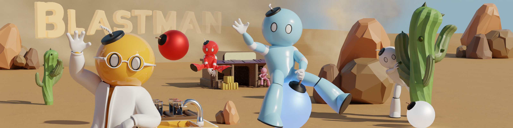

<p align="center">
  
</p>

<h1 align="center">Atomic Blastman Press Kit</h1>

<p align="center">
  Official press kit for Atomic Blastman by Indiependent Games Studio.
</p>

<p align="center">
  <a href="https://store.steampowered.com/app/4142990/Atomic_Blastman/"><b>⭐ Wishlist on Steam</b></a>
  &nbsp;&nbsp;|&nbsp;&nbsp;
  <a href="https://indiependentgamesstudio.com"><b>🌐 Website</b></a>
  &nbsp;&nbsp;|&nbsp;&nbsp;
  <a href="mailto:official@indiependentgamesstudio.com"><b>📧 Press Contact</b></a>
</p>

---

For game details, see the [Fact Sheet](01_Press_Info/AtomicBlastman_FactSheet.pdf) and [FAQ](01_Press_Info/AtomicBlastman_FAQ.pdf).

## Structure

```
01_Press_Info/              Fact Sheet and FAQ
02_Logos/                   Logos
└── Game_Icon/              Game icon in several sizes and formats
03_Key_Art/                 Cover art, with and without logo
├── Covers/
├── Banner/
├── Portrait/
└── Classic_4x3/
04_Screenshots/
├── Featured/               Best picks
├── Arenas/                 Gameplay by arena
│   ├── Beta_Lab/
│   ├── Candy_Arena/
│   ├── Factory/
│   ├── Mossreach_Ruins/
│   └── Wild_West/
├── Factory_Lobby/
├── Map_Editor/
└── Menus/
05_Videos/
├── Gameplay_Clips/
├── GIFs/
└── Creator_Assets/         Dancing Blastman, including green screen
06_Characters/
├── Blue_Blastman_Poses/
└── Character_Art/
07_Promotional_Art/
├── Social_Posts/
├── Showcases/
└── Banners/
08_Behind_the_Scenes/       Models, sketches and comparisons
├── Early_Builds/
└── Devlog_Art/
09_Store_Assets/
└── Steam/
```

## Usage

All assets are free to use for coverage of Atomic Blastman: articles, reviews, videos, streams and social media, including monetized content. Please don't alter the logo or characters.

## Contact

[official@indiependentgamesstudio.com](mailto:official@indiependentgamesstudio.com)

Socials are linked in the footer of [indiependentgamesstudio.com](https://indiependentgamesstudio.com) and on [Linktree](https://linktr.ee/indiependent.games.studio).

<p align="center">
  <sub>© Indiependent Games Studio</sub>
</p>
